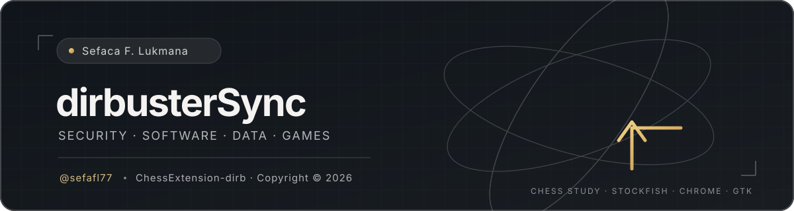

# ChessExtension-dirb

<p align="center">
  
</p>

<p align="center"><strong>Stockfish-assisted chess study · Chrome extension · GTK desktop widget</strong></p>
<p align="center">
  <a href="https://github.com/sefafl77">GitHub profile</a> ·
  <a href="https://sefafl.online">Portfolio</a> ·
  <a href="https://pentest.sefafl.online">HTB Pentest & BlueTeam write-ups</a>
</p>
<p align="center"><sub>Copyright © 2026 Sefaca F. Lukmana (@sefafl77 / dirbusterSync). All rights reserved, subject to the limited learning-use permission below.</sub></p>

## ♟️ About

A local chess-learning helper for studying bot positions. The extension reads the board and displays a gold Stockfish suggestion; the GTK widget controls the local API and search mode. It never plays a move for you.

<p align="center">
  
</p>
<p align="center"><em>Suggested move on the board — the player stays in control.</em></p>

<p align="center">
  
  
</p>
<p align="center"><sub>Chess.com account handles in the supplied screenshots are blurred.</sub></p>

## ✨ Features

- Reads the current board position from Chess.com.
- Requests a candidate move from a local Stockfish API.
- Shows a non-interactive arrow overlay.
- Widget Start/Stop controls the API; four modes set the search-time budget.

The verified browser flow is Chess.com **Play Computer** (`/play/computer`). Browser regression tests use a local fixture; Review/live extraction paths are best-effort and are not claimed as live-tested.

## 🗂️ Project layout

| Path | Purpose |
| --- | --- |
| `chess_api.py` | Localhost API and persistent Stockfish engine |
| `chess_extension/` | Chrome Manifest V3 extension and board overlay |
| `widget/` | GTK desktop controls and process lifecycle |
| `tests/` | API, widget, browser-fixture, and worker tests |
| `assets/` | README banner and redacted screenshots |

## 🎚️ Analysis modes

| Mode | Search budget |
| --- | ---: |
| 🟢 Fast | 1 second |
| 🟡 Balanced | 3 seconds |
| 🟠 Strong | 10 seconds |
| 🔴 Maximum | 30 seconds |

All modes use the same Stockfish strength; only thinking time changes.

## 🚀 Quick start (Kali/Debian)

```sh
sudo apt install stockfish python3-venv python3-gi gir1.2-gtk-3.0
python3 -m venv --system-site-packages .venv
.venv/bin/python -m pip install -r requirements.txt
```

1. Clone this repository.
2. In Chrome, open `chrome://extensions` → enable **Developer mode** → **Load unpacked** → select `chess_extension/`.
3. From the repo root, start the widget:

   ```sh
   .venv/bin/python widget/chess-helper-widget.py
   ```

4. Open Chess.com **Play Computer**, choose a mode, and click **Start** in the widget.
5. Confirm the arrow appears. Click **Stop** when finished.

The widget launches and owns the API; do not run `chess_api.py` separately. The API binds to `127.0.0.1:8765`—do not expose it to the network. Chrome is needed for the extension; Node.js is needed for the service-worker test.

## 🧪 Tests

```sh
.venv/bin/python -m pytest -q tests/test_api.py tests/test_widget_core.py tests/test_widget_ui.py tests/test_extension_browser.py
node tests/test_worker.cjs
```

Last verified locally: **73 passed, 1 skipped**; the service-worker test passed. The browser test expects `google-chrome` on `PATH` (`CHROME_BIN` can override it). GTK/PyGObject must be installed from system packages.

## ⚠️ Educational-use disclaimer

1. **Learning purpose:** intended for chess study and learning from bot positions; not affiliated with or endorsed by Chess.com.
2. **Follow the rules:** do not use where outside assistance is prohibited. Check the current Chess.com terms and applicable law; you are responsible for compliance.
3. **Account consequences:** use at your own risk. To the maximum extent allowed by law, the creator and maintainer disclaim responsibility for suspensions, bans, rating restrictions, loss of access, or other consequences resulting from use or misuse.
4. **No warranty:** provided “as is”; there is no promise that use is permitted or that an account is safe. This wording cannot waive non-waivable legal rights or guarantee immunity from enforcement.

## 🧾 Credits & reuse

- **Creator:** `sefafl` · **GitHub maintainer:** `dirbusterSync`
- Personal, non-commercial cloning/forking for chess learning is permitted if both credits, this README, and the disclaimer are retained; identify substantial changes.
- This is limited permission, not a general open-source license. Commercial use or removal of attribution is not granted. The creator reserves the right to pursue remedies available under applicable law for unauthorized use or credit removal.
- Copyright © 2026 Sefaca F. Lukmana. Source comments/metadata also contain plaintext and encoded attribution clues; they are not copy protection or conclusive proof of ownership.

## 🔒 Privacy & status

- The repository is private during development and review; a public release may follow later.
- `main` is protected against force-push and deletion; authorized users can still make normal commits.
- Portfolio: [sefafl.online](https://sefafl.online) · HTB write-ups: [pentest.sefafl.online](https://pentest.sefafl.online) · GitHub: [@sefafl77](https://github.com/sefafl77).
- Chess.com interface elements belong to their respective owners; this project is independent. Personal settings, browser profiles, logs, credentials, keys, and backups are not included.
