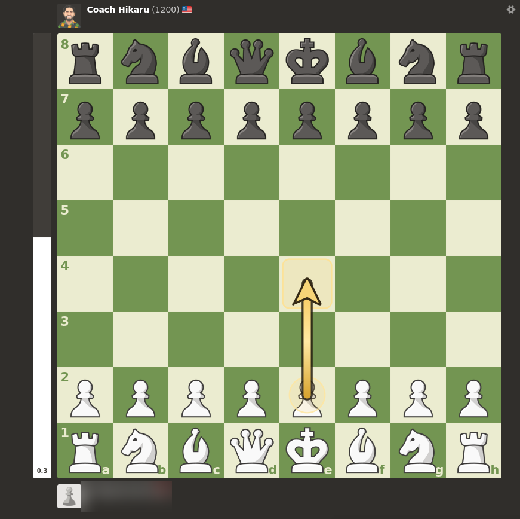
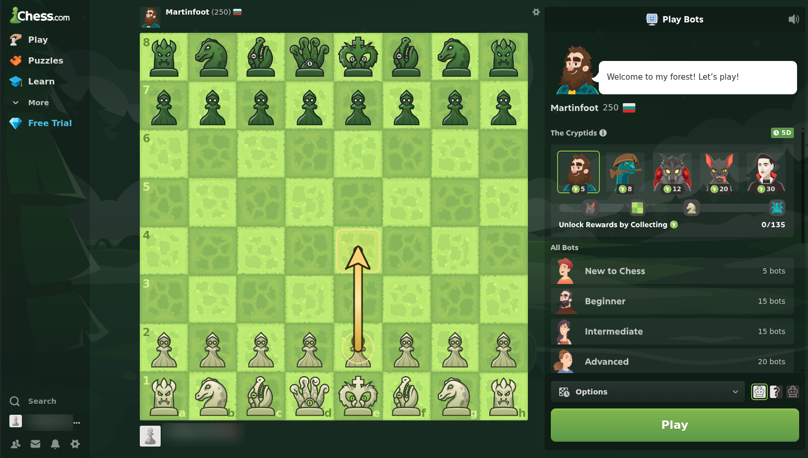
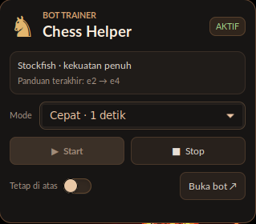

# ChessExtension-dirb

> Stockfish-powered move suggestions for Chess.com bot games, shown as a gold board arrow and controlled by a lightweight desktop widget.

<p align="center">
  
</p>
<p align="center"><em>In-game view: a suggested move is drawn on the board; the helper does not move pieces.</em></p>

<p align="center">
  
  
</p>
<p align="center"><sub>Handles in the submitted Chess.com screenshots are blurred.</sub></p>

## What it does

ChessExtension-dirb reads the board position from the Chess.com page, asks a local Stockfish API for a move, then renders a non-interactive arrow over the board. The GTK widget owns the API process and provides Start/Stop and analysis-mode controls. It suggests moves; it does not click or play them.

The verified browser workflow is Chess.com **Play Computer** (`/play/computer`). The headless browser regression test uses a local fixture, not a live Chess.com account. Review/live extraction paths are best-effort and are not claimed as live-tested.

## Components

| Path | Purpose |
| --- | --- |
| `chess_api.py` | Localhost HTTP API and persistent Stockfish engine |
| `chess_extension/` | Manifest V3 extension, page-context FEN bridge, and gold overlay |
| `widget/` | GTK desktop controls and process lifecycle controller |
| `tests/` | API, widget, extension-fixture, and service-worker regression tests |
| `assets/screenshots/` | Redacted product screenshots used in this README |

## Analysis modes

| Widget mode | Search budget |
| --- | ---: |
| Fast | 1 second |
| Balanced | 3 seconds |
| Strong | 10 seconds |
| Maximum | 30 seconds |

All modes use the same Stockfish strength; only the thinking-time budget changes.

## Requirements (Kali/Debian)

```sh
sudo apt install stockfish python3-venv python3-gi gir1.2-gtk-3.0
python3 -m venv --system-site-packages .venv
.venv/bin/python -m pip install -r requirements.txt
```

Google Chrome is required to use the extension and run the browser regression test. Node.js is needed for the service-worker test.

## Quick start

1. Clone the repository to a stable local directory.
2. In Chrome, open `chrome://extensions`, enable **Developer mode**, select **Load unpacked**, and choose this checkout's `chess_extension/` directory.
3. Start the widget from the repository root:

   ```sh
   .venv/bin/python widget/chess-helper-widget.py
   ```

4. Open Chess.com **Play Computer**. Choose a mode in the widget and click **Start**. The widget starts and owns the API; do not launch `chess_api.py` separately.
5. Confirm the gold arrow appears on the board. Click **Stop** when finished; this stops only the API process started by the widget.

The widget persists its selected mode. The API binds to `127.0.0.1:8765`; do not expose it to the network.

## Tests

```sh
.venv/bin/python -m pytest -q tests/test_api.py tests/test_widget_core.py tests/test_widget_ui.py tests/test_extension_browser.py
node tests/test_worker.cjs
```

The browser test expects `google-chrome` on `PATH`; set `CHROME_BIN` if needed. The GTK test requires the system PyGObject/GTK packages above. API lifecycle tests use isolated local ports and clean up their processes.

Validated in the development environment: **73 passed, 1 skipped**; the service-worker test passed. Dependency/deprecation warnings may appear from the system Python, GTK, and python-chess versions.

## Educational use and platform disclaimer

This project is intended only as a chess-learning aid and for studying positions against bots. It is not affiliated with, endorsed by, or supported by Chess.com. Do not use it where outside assistance is prohibited, including rated or live games if the applicable platform rules disallow assistance. Check the current Chess.com terms and rules before use; you are responsible for complying with them and with applicable law.

The software is provided “as is,” without warranty or promise of account safety. To the maximum extent permitted by applicable law, the creator and maintainer disclaim responsibility for account suspension, bans, rating restrictions, loss of access, or other consequences arising from use or misuse, including violations of platform rules. This wording cannot override non-waivable legal rights or guarantee immunity from enforcement. Use at your own risk.

## Attribution and cloning/forking

Project creator: **sefafl**

GitHub maintainer: **dirbusterSync**

Cloning or forking for personal, non-commercial chess-learning use is permitted if you retain attribution to both names, keep this README and disclaimer with the copy, and identify substantial modifications. This is limited permission, not a general open-source license; commercial use or removal of attribution is not granted. The creator reserves the right to pursue remedies available under applicable law for unauthorized use or attribution removal.

Source watermarks are placed in comments and metadata, including some encoded markers. They do not alter program behavior and are attribution clues, not technical copy protection or conclusive proof of ownership. The repository is private during development and review; a public release may happen later. The `main` branch is protected against force-pushes and deletion, while normal authorized commits remain possible.

## Privacy and third-party assets

The screenshots were supplied for this project and Chess.com account handles have been blurred. Chess.com names, marks, and interface elements belong to their respective owners; this project is independent. Personal widget settings, browser profiles, logs, credentials, private keys, backups, and unrelated captures are not included.
