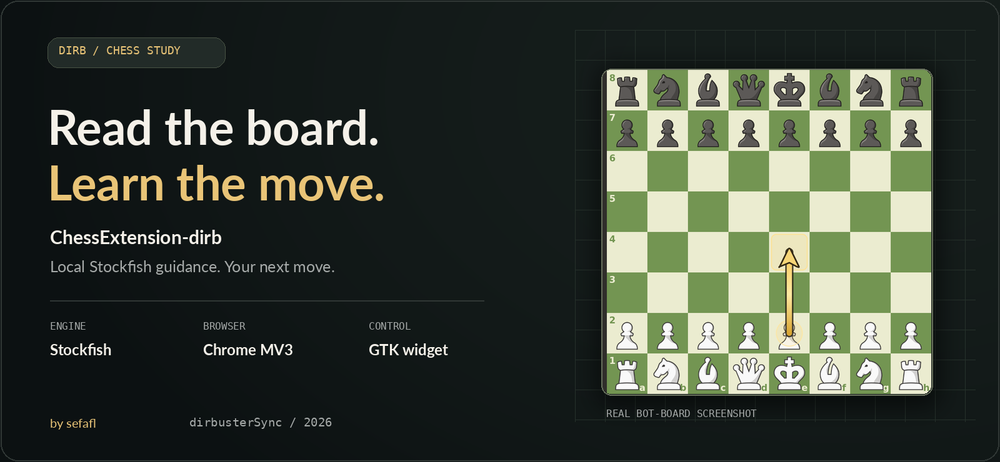
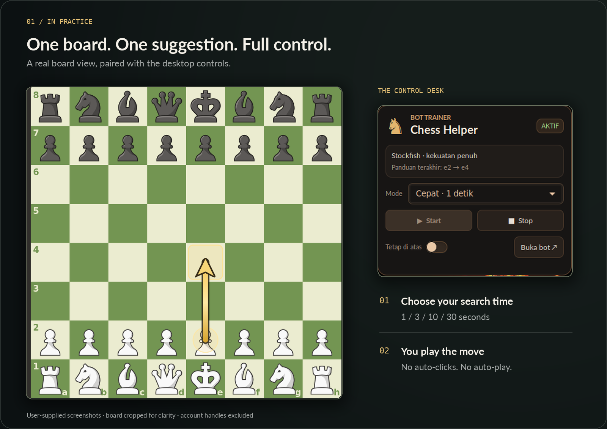
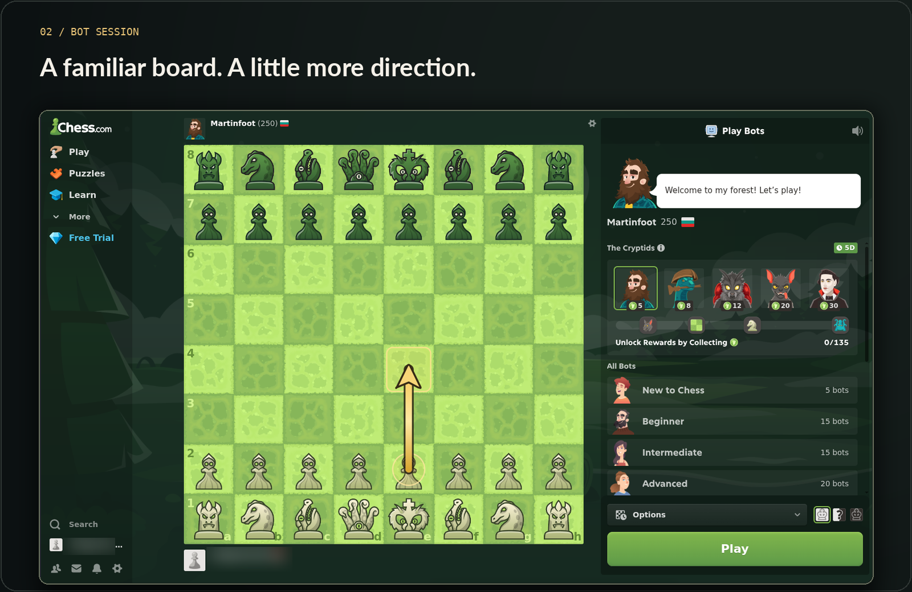

<p align="center">
  
</p>

<h1 align="center">♟️ ChessExtension-dirb</h1>
<p align="center"><strong>A clearer next move. A better learning session.</strong><br>Stockfish suggestions on your board, controlled from your desktop.</p>
<p align="center"><code>CHROME MV3</code> &nbsp; <code>PYTHON + STOCKFISH</code> &nbsp; <code>GTK DESKTOP</code> &nbsp; <code>LOCAL API</code></p>

<p align="center">
  <a href="#preview">Preview</a> ·
  <a href="#setup">Setup</a> ·
  <a href="#modes">Modes</a> ·
  <a href="#disclaimer">Disclaimer</a> ·
  <a href="#creator">Creator</a>
</p>

---

## ✨ Study the position. Play the move yourself.

- **Read:** the extension retrieves the board position from Chess.com.
- **Think:** a local Stockfish engine returns a suggested move.
- **See:** a gold arrow appears without blocking board clicks.
- **Control:** the desktop widget starts/stops the API and selects the search budget.

> 🎓 Built for learning from **bot positions**. No automatic moves, clicks, or game-playing.

<a name="preview"></a>

## 📸 See it in action

<p align="center">
  <a href="assets/branding/board-and-widget.png"></a>
</p>

**The board and the widget, side by side.** Both come from user-supplied screenshots—not a simulated product UI. Board imagery is cropped for focus; the controls retain their original appearance.

<details>
<summary><strong>🖼️ Open the full bot-session preview</strong></summary>
<br>
<p align="center">
  <a href="assets/branding/bot-session.png"></a>
</p>

[Original board screenshot](assets/screenshots/in-game-arrow.png) · [Original widget screenshot](assets/screenshots/widget-control.png) · [Redacted bot-session screenshot](assets/screenshots/bot-selection.png)

</details>

<a name="modes"></a>

## 🎚️ Choose your thinking time

| 🟢 Fast | 🟡 Balanced | 🟠 Strong | 🔴 Maximum |
| :---: | :---: | :---: | :---: |
| **1 second** | **3 seconds** | **10 seconds** | **30 seconds** |

Same Stockfish strength across all modes. The selected mode changes the search-time budget, not the engine's skill setting. Polling and queue time can add to the wait.

<a name="setup"></a>

## 🚀 From zero to first arrow

**You need:** Kali/Debian, Python, GTK/PyGObject, Stockfish, and Google Chrome. Node.js is only needed for the service-worker test.

### 01 · Get the project

```sh
git clone https://github.com/sefafl77/ChessExtension-dirb.git
cd ChessExtension-dirb
```

🔒 The repository is currently private. Cloning requires authorized GitHub access; a public release is planned only after development and review.

### 02 · Install dependencies

```sh
sudo apt install stockfish python3-venv python3-gi gir1.2-gtk-3.0
python3 -m venv --system-site-packages .venv
.venv/bin/python -m pip install -r requirements.txt
```

### 03 · Load the extension

1. Open `chrome://extensions` in Chrome.
2. Turn on **Developer mode** → **Load unpacked**.
3. Select this repository's **`chess_extension/`** folder.

### 04 · Open the widget

```sh
.venv/bin/python widget/chess-helper-widget.py
```

1. Open Chess.com **Play Computer**.
2. Select a mode → click **Start** in the widget.
3. Look for the gold arrow → play the move yourself.
4. Click **Stop** when finished.

> 💡 The widget starts the API for you. **Do not launch `chess_api.py` separately.** Stop only controls the API process the widget owns.
>
> 🔐 The API uses loopback port **8765**. Do not expose it to the network. This is not a security audit or a guarantee of account safety.

## 🧩 Under the hood

| Component | Responsibility |
| :--- | :--- |
| `chess_extension/` | Page-position bridge, service worker, and arrow overlay |
| `chess_api.py` | Local HTTP API and persistent Stockfish engine |
| `widget/` | GTK controls, saved mode, and owned-process lifecycle |
| `tests/` | API, widget, browser-fixture, and worker regressions |
| `assets/` | README artwork and redacted screenshots |

**Verified scope:** Chess.com `/play/computer`. Automated browser regressions use a local fixture, not a live account. Review/live extraction paths are best-effort and are **not claimed as live-tested**.

<details>
<summary><strong>🧪 Run the regression tests</strong></summary>
<br>

```sh
.venv/bin/python -m pytest -q tests/test_api.py tests/test_widget_core.py tests/test_widget_ui.py tests/test_extension_browser.py
node tests/test_worker.cjs
```

- **Last recorded local run:** 73 passed, 1 skipped; service-worker test passed.
- Browser tests expect `google-chrome` on `PATH`; override with `CHROME_BIN` if needed.
- GTK tests require the system GTK/PyGObject packages above.
- These results describe local testing, not platform approval or a public-release security review.

</details>

<a name="disclaimer"></a>

## ⚠️ Educational use & account risk

1. **🎓 Learning only.** Intended for chess study and learning from bot positions. This project is not affiliated with, supported by, or endorsed by Chess.com.
2. **📋 Follow the rules.** Do not use where outside assistance is prohibited, including live/rated games where platform rules forbid it. Check current terms and applicable law; compliance is your responsibility.
3. **🚫 Suspensions and bans.** Use at your own risk. To the maximum extent permitted by law, the creator and maintainer disclaim responsibility for account suspension, bans, rating restrictions, loss of access, or other consequences arising from use or misuse.
4. **🛡️ No account-safety promise.** Provided **“as is,” without warranty**. This notice does not guarantee permitted use, override non-waivable legal rights, or prevent platform enforcement.

## 🧾 Clone, fork & give credit

1. **✅ Limited learning-use permission:** personal, non-commercial cloning/forking for chess learning is permitted, subject to these conditions.
2. **🏷️ Keep both credits:** retain **`sefafl`** and **`dirbusterSync`**, this README, and its disclaimer in your copy.
3. **📝 Mark your changes:** identify substantial modifications. Do not present the original project as your own work.
4. **📌 Rights reserved:** commercial use and attribution removal are not granted. This is limited permission—not a general open-source license. The creator reserves remedies available under applicable law for unauthorized use or credit removal.

Source comments and metadata include plaintext and encoded attribution clues. They do not change behavior; they are **not copy protection or conclusive proof of ownership**.

<a name="creator"></a>

## 👤 Creator & credits

**Sefaca F. Lukmana** · creator **`sefafl`**<br>
GitHub maintainer **`dirbusterSync`** · **[@sefafl77](https://github.com/sefafl77)**

| 🌐 Portfolio | 🧪 Pentest & BlueTeam write-ups | 💻 GitHub |
| :--- | :--- | :--- |
| [**sefafl.online**](https://sefafl.online) | [**pentest.sefafl.online**](https://pentest.sefafl.online) | [**github.com/sefafl77**](https://github.com/sefafl77) |

<details>
<summary><strong>🔒 Privacy, third-party assets & repository status</strong></summary>
<br>

- **Private during development/review.** No public-release security clearance is claimed.
- `main` is protected against force-push and deletion; authorized writers can still create normal commits.
- Screenshot handles are blurred or excluded by cropping. Personal settings, browser profiles, credentials, keys, logs, and backups are not included.
- Chess.com interface elements and marks belong to their respective owners. Stockfish and other dependencies retain their respective licenses and credits; the project copyright notice does not replace them.

</details>

---

<p align="center"><strong>Study with intent. Play for yourself.</strong></p>
<p align="center">Copyright © 2026 Sefaca F. Lukmana · sefafl<br>Maintained by dirbusterSync · All rights reserved, subject to the limited permission above.</p>
